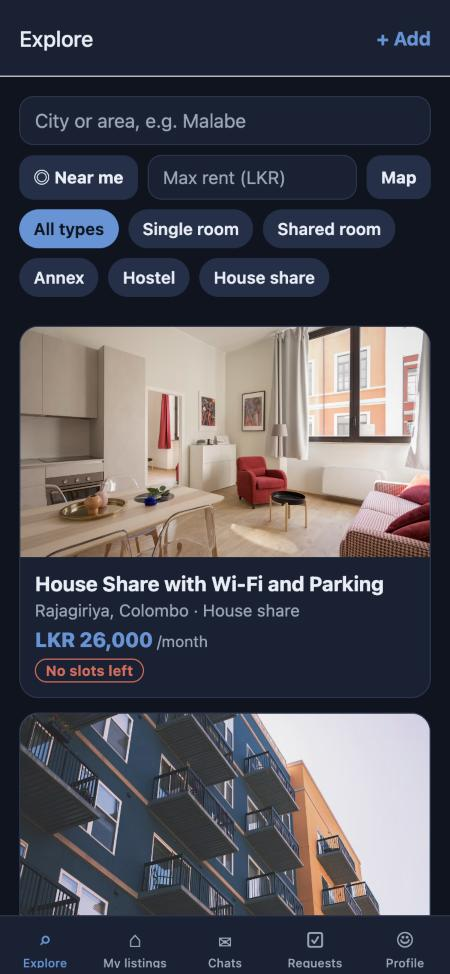
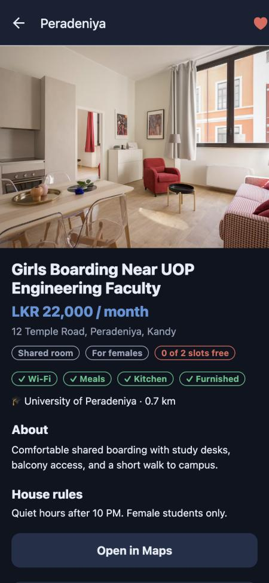
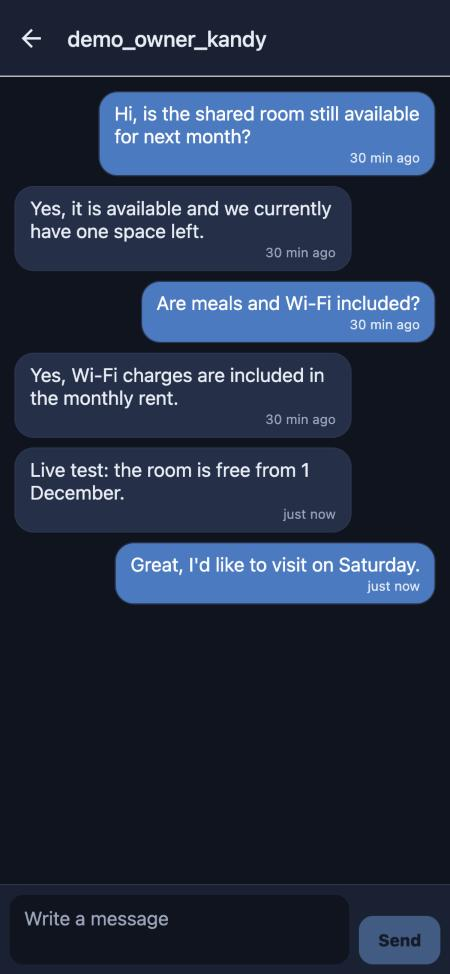
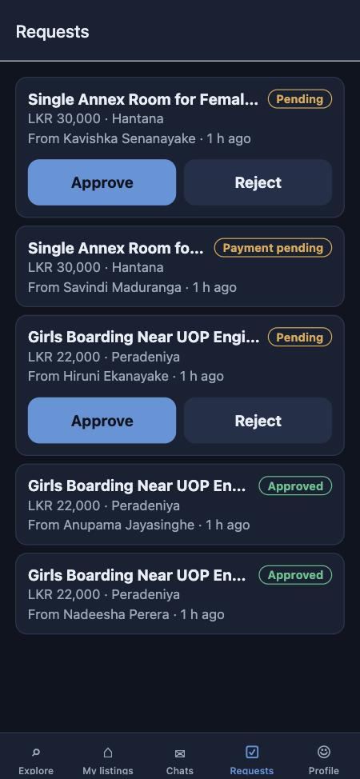
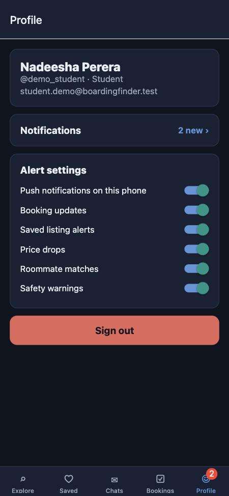

# BoardingFinder Mobile

[](https://github.com/naweedhah/boardingfinder-mobile/actions/workflows/ci.yml)

The iOS and Android app for [BoardingFinder](https://github.com/naweedhah/boardingfinder-laravel), a student
boarding (rental room) platform for Sri Lanka. Students find rooms near their campus, chat with owners in real
time and request a booking; owners list rooms with photos from the phone camera and approve requests.

It is a second client for the same Laravel API the React web app uses. Building it meant extending the API
to serve a phone properly (token login, push notifications) without breaking the browser client.

**Stack:** React Native 0.88 · Expo SDK 58 · TypeScript (strict) · Expo Router · TanStack Query (persisted
cache) · React Hook Form + Zod · Laravel Echo + Reverb (WebSockets) · expo-notifications · expo-secure-store ·
react-native-maps · Jest + React Native Testing Library · GitHub Actions · EAS Build

| Explore | Listing | Live chat | Owner requests | Profile |
| --- | --- | --- | --- | --- |
|  |  |  |  |  |

## Features

**Students**
- Search by city or area, room type and maximum rent; **"Near me"** uses the phone's GPS and a 1–10 km radius, with results sorted by real distance
- List and **map view** of listings with a radius circle
- Listing page: photo gallery, facilities, campus distance, house rules, reviews, open in Maps
- Save listings (works offline once loaded), request a booking, rate a listing
- **Real-time chat** with owners, with a warning on messages the server's scam detector flags
- Booking tracker, notification centre and per-category alert settings

**Owners**
- Booking requests with approve/reject; approving opens a chat with the student
- **Add a listing from the phone:** take photos with the camera (or pick from the library) and pin the
  location with GPS; the form validates before upload and shows the API's field errors inline

**Both**
- **Push notifications** for booking updates, new messages and saved-search alerts; tapping one opens the right screen
- Light and dark mode, offline banner, pull to refresh

## Engineering decisions

| Problem | What I did |
| --- | --- |
| The web app's httpOnly cookie doesn't suit a phone | Added `POST /api/auth/mobile/login` to the API, which returns a Sanctum token with a per-device name. The app keeps it in the **iOS Keychain / Android Keystore** (`expo-secure-store`), never in AsyncStorage, and sends it as a bearer token. The API's single guard accepts either the cookie or the header, so the web client was untouched. Logging out revokes only this device's token ([`AuthProvider`](src/auth/AuthProvider.tsx), [API PR](https://github.com/naweedhah/boardingfinder-laravel/pull/2)) |
| A revoked or expired token must not leave the app half-signed-in | The API client signs the user out on 401, or on 403 *only* when the server says the token itself was rejected; an ordinary 403 ("only students can book") is shown as an error instead ([`client.ts`](src/api/client.ts)) |
| Patchy mobile data | TanStack Query cache is **persisted to AsyncStorage** (24 h) and NetInfo drives React Query's online state, so the app opens with listings, chats and bookings while offline, pauses requests without a connection, and refetches when the phone comes back online or the app returns to the foreground. A launch without signal keeps the cached profile rather than signing the user out |
| Chat that feels instant | Messages appear immediately as "Sending…" (optimistic update), are swapped for the stored copy when the API answers, and are removed with the text restored to the input if sending fails. Incoming messages arrive over **Laravel Reverb** on the private channel `users.{id}`, authorised with the same bearer token, and are written straight into the query cache; a duplicate from the WebSocket echo is dropped by id ([`useSendMessage`](src/hooks/api.ts), [`RealtimeProvider`](src/realtime/RealtimeProvider.tsx)) |
| Save button lag | Optimistic toggle with rollback on failure |
| Push without holding Apple/Google keys on the server | The app registers its Expo push token with the API; the API queues a job that sends through Expo's push service (APNs + FCM), respects the user's push setting and deletes tokens of uninstalled apps. Notification taps deep-link using the payload's `type` and ids ([`routeForNotification`](src/push/routeForNotification.ts)) |
| Same validation on phone and server | Zod schemas mirror the Laravel Form Requests rule for rule and message for message (Sri Lanka map bounds, 10-digit phones, 10-word descriptions…). Server-only checks (username taken) come back as 422/409 field errors and are shown under the matching input ([`schemas.ts`](src/validation/schemas.ts)) |
| Signed-out users deep-linking into the app | `Stack.Protected` guards remove the app's routes until a session exists |
| Multipart photo upload differs by platform | React Native's FormData takes `{ uri, name, type }` parts, the browser needs Blobs; one helper builds both and names the field `images[]` so PHP keeps every photo ([`listingForm.ts`](src/lib/listingForm.ts)) |

## Project structure

```
src/
  app/                 Expo Router screens (file = route)
    (tabs)/            Explore, Saved/My listings, Chats, Bookings/Requests, Profile
    listing/[id].tsx   chat/[id].tsx   add-listing.tsx   notifications.tsx   sign-in.tsx   register.tsx
  api/                 typed fetch client, endpoint functions, API types
  auth/                AuthProvider, secure token storage (+ web fallback)
  hooks/               React Query hooks (optimistic mutations), query keys
  realtime/            Laravel Echo / Reverb connection
  push/                push registration and notification deep links
  validation/          Zod schemas shared by the forms
  components/          UI primitives, listing card, map (native + web stand-in)
__tests__/             Jest + React Native Testing Library
```

## Run it

You need the [Laravel API](https://github.com/naweedhah/boardingfinder-laravel) running (`php artisan serve`
and, for live chat, `php artisan reverb:start`) with the demo seed data.

```bash
npm install
cp .env.example .env.local     # set EXPO_PUBLIC_API_URL to your computer's LAN IP for a real phone
npx expo start                 # press a (Android emulator), i (iOS simulator) or w (web preview)
```

Sign in with `demo_student` / `password123` (or `demo_owner_kandy` for the owner side).

- **Expo Go** runs everything except remote push notifications. For push, make a development build:
  `npx eas-cli init` (adds the EAS project id), then `npx eas-cli build --profile development`.
- **Installable Android APK:** `npx eas-cli build -p android --profile preview`.
- The **web preview** is for quick checks: maps, camera and push are native-only, and the token is kept in
  `sessionStorage` there because browsers have no keystore.

## Tests

```bash
npm test          # 42 Jest tests
npm run typecheck # tsc --noEmit (strict, noUncheckedIndexedAccess)
npm run lint
```

Covered: the API client (bearer header, 422 field errors, which 403s end the session, offline errors), query
building for near-me search, every validation rule against the server's wording, optimistic save and chat
updates including rollback and WebSocket de-duplication, push deep-link routing, and the sign-in screen.
CI also bundles every route with `expo export` to catch broken imports.
